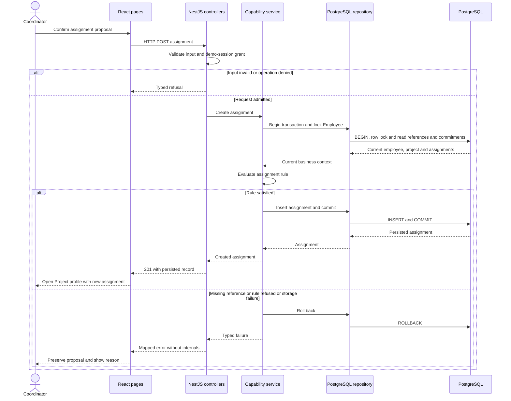

# Assignment request interaction

## Reading

Realizes [Assign employee to project](../../requirements/capabilities/project-assignments/use-cases/assign-employee-to-project.md). Other reads traverse the same API/service/repository boundary without a mutation. Employee updates share the employee lock before validating existing commitments.
