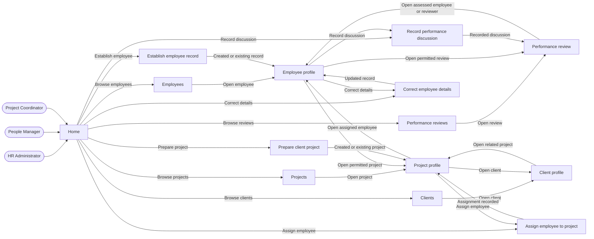

# HR-Prototype navigation

## Reading

The shared Home renders each role's launchers. Links appear only when authorized; arrows between related records do not grant access. The [page set](../page-set.md) owns every node. Forms return to their origin on cancellation and stay on the form on refusal. A shared Home link is available from every page.
