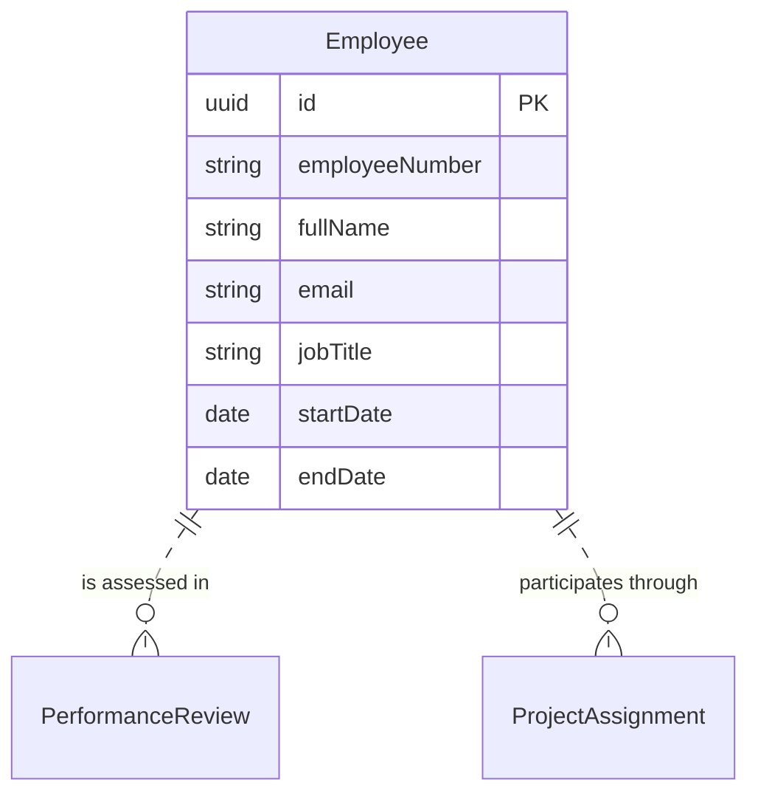

# Employee logical data model

## Reading

Employee is primary. It can be assessed in many reviews and participate in many assignments. External PerformanceReview belongs to its own aggregate; external ProjectAssignment belongs to Project.
