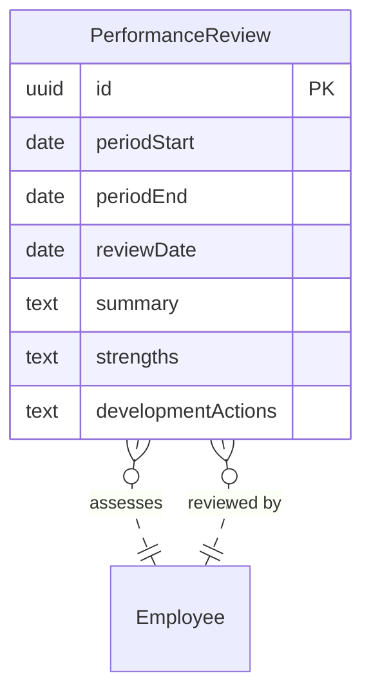

# PerformanceReview logical data model

## Reading

PerformanceReview is primary. Each review assesses exactly one Employee and is reviewed by exactly one Employee: two distinct roles pointing to the external Employee aggregate. An employee can appear on many reviews in either role.
