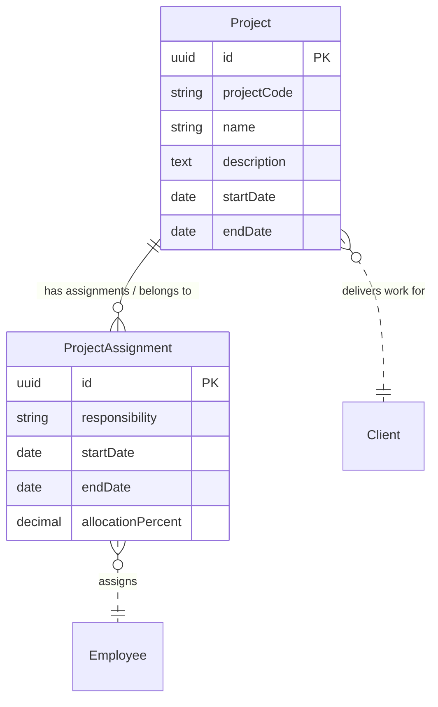

# Project logical data model

## Reading

Project is primary and ProjectAssignment supports it. Every Project references one external Client and owns zero or more assignments. Every assignment belongs to one Project and assigns one external Employee. Employees can have many assignments.
