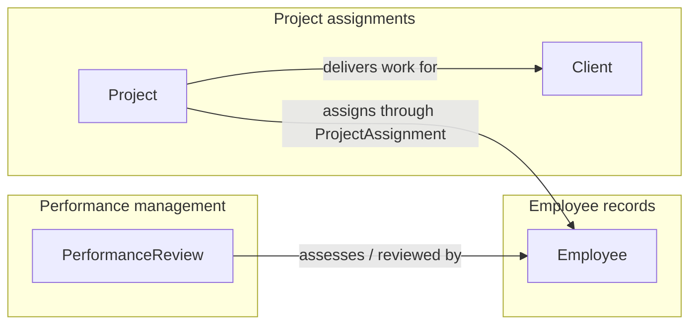

# HR-Prototype conceptual data model

## Reading

PerformanceReview assesses an Employee and names an Employee as reviewer. Project delivers work for Client. Its supporting ProjectAssignment connects it to Employee. Employee has one home, shared across capabilities. ProjectAssignment is inside Project, not a separate aggregate.

## Logical models

- [Employee](erd-employee.md)
- [PerformanceReview](erd-performance-review.md)
- [Client](erd-client.md)
- [Project and ProjectAssignment](erd-project.md)
