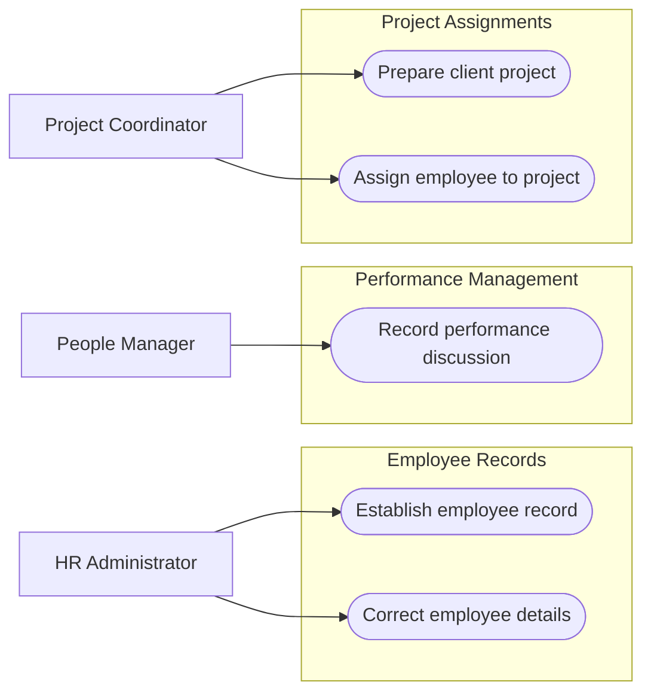

# HR-Prototype use cases

## Reading

Rectangles are business roles; rounded nodes are goals. HR establishes and corrects employee records. Managers record performance discussions. Coordinators prepare projects and assign employees.
